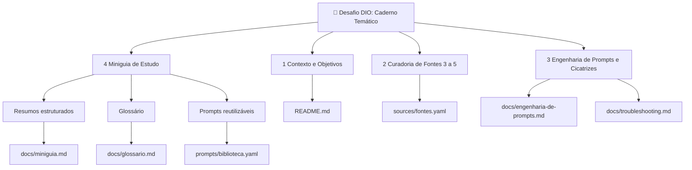
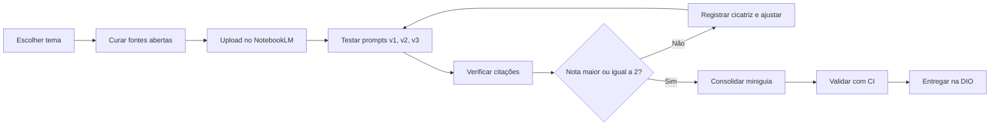
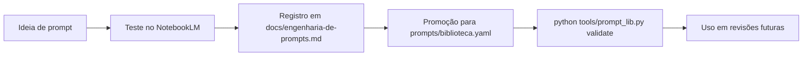
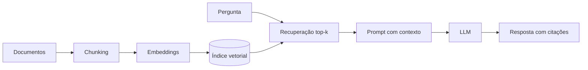

# 📚 Miniguia de Estudos: RAG com NotebookLM

[](https://github.com/josewagnerbljr-sys/miniguia-estudos-notebooklm/actions)


Projeto do desafio da DIO **"Caderno Temático no NotebookLM"**. Usei IA como ferramenta de **aprendizagem ativa** para estudar **RAG (Retrieval-Augmented Generation)**, transformando 5 fontes abertas em um miniguia de estudo, um glossário e uma biblioteca de prompts reutilizáveis, versionada e validada automaticamente.

## Índice

1. [Organograma do desafio](#1-organograma-do-desafio)
2. [Contexto e Objetivos](#2-contexto-e-objetivos)
3. [Curadoria de Fontes](#3-curadoria-de-fontes)
4. [Metodologia e fluxo de trabalho](#4-metodologia-e-fluxo-de-trabalho)
5. [Engenharia de Prompts e Cicatrizes](#5-engenharia-de-prompts-e-cicatrizes)
6. [Miniguia de Estudo (entrega final)](#6-miniguia-de-estudo-entrega-final)
7. [Estrutura do repositório](#7-estrutura-do-repositório)
8. [Tecnologias e melhorias](#8-tecnologias-e-melhorias)
9. [Como usar](#9-como-usar)
10. [Requisitos do desafio: checklist](#10-requisitos-do-desafio-checklist)
11. [Limitações e honestidade metodológica](#11-limitações-e-honestidade-metodológica)
12. [Licença e citação](#12-licença-e-citação)

---

## 1. Organograma do desafio

### 1.1 Visão geral das entregas



### 1.2 Fluxo de execução do projeto



### 1.3 Ciclo de vida da biblioteca de prompts



---

## 2. Contexto e Objetivos

### Assunto escolhido

**RAG (Retrieval-Augmented Generation)**: a técnica que conecta modelos de linguagem a bases de conhecimento externas para reduzir alucinações e responder com dados atuais e privados. É o alicerce de assistentes corporativos, sistemas de busca semântica e agentes de IA, e um tema em que a qualidade do estudo depende de checar fontes.

### Objetivos de estudo

| # | Objetivo | Como medir |
|---|---|---|
| O1 | Entender o pipeline de RAG e suas variantes (Naive, Advanced, Modular) | Explicar o pipeline sem consulta e desenhá-lo |
| O2 | Saber quando e por que técnicas como busca híbrida e reranking ajudam | Escolher técnica para 3 cenários fictícios |
| O3 | Compreender os limites do contexto longo | Explicar "lost in the middle" com exemplo |
| O4 | Aprender a avaliar sistemas RAG | Diferenciar as 4 métricas do RAGAS |
| O5 | Dominar o NotebookLM como ferramenta de aprendizagem ativa | Biblioteca de prompts com nota média maior ou igual a 2 |

### Perguntas norteadoras

1. Que problema o RAG resolve que o fine-tuning não resolve?
2. Como cada etapa do pipeline pode falhar?
3. Mais contexto significa melhor resposta?
4. Como sei que uma resposta RAG é fiel às fontes?

---

## 3. Curadoria de Fontes

Cinco fontes **abertas** (artigos no arXiv), escolhidas para cobrir origem, panorama, limites, avaliação e técnica avançada. Metadados em [`sources/fontes.yaml`](sources/fontes.yaml).

| ID | Fonte | Tipo | Por que entrou |
|---|---|---|---|
| F1 | [Lewis et al. (2020) RAG for Knowledge-Intensive NLP](https://arxiv.org/abs/2005.11401) | Fundacional | Define o conceito |
| F2 | [Gao et al. (2023) RAG for LLMs: A Survey](https://arxiv.org/abs/2312.10997) | Survey | Panorama e taxonomia |
| F3 | [Liu et al. (2023) Lost in the Middle](https://arxiv.org/abs/2307.03172) | Empírico | Limites do contexto longo |
| F4 | [Es et al. (2023) RAGAS](https://arxiv.org/abs/2309.15217) | Avaliação | Métricas de qualidade |
| F5 | [Asai et al. (2023) Self-RAG](https://arxiv.org/abs/2310.11511) | Técnica avançada | RAG adaptativo e autocrítico |

**Critérios de seleção:** acesso aberto, relevância (fundacional ou muito citada), diversidade de papéis (teoria, panorama, evidência, prática), quantidade dentro do limite do desafio (3 a 5) e possibilidade de conferir tudo por citação.

**Upload no NotebookLM:** baixar o PDF de cada link (botão *PDF* do arXiv) ou colar a URL como fonte, e nomear cada fonte com o ID (F1 a F5) para facilitar a rastreabilidade.

---

## 4. Metodologia e fluxo de trabalho

Aprendizagem ativa em quatro movimentos: **perguntar** (prompts estratégicos), **verificar** (clicar nas citações), **consolidar** (miniguia e glossário) e **praticar** (quiz e flashcards).

| Etapa | Recurso do NotebookLM (conforme disponível na sua interface) | Uso |
|---|---|---|
| Explorar | Chat com citações | Perguntas guiadas e checagem de fontes |
| Sintetizar | Guia de estudo, resumos e mapa mental | Base para o miniguia |
| Revisar | Flashcards e quizzes | Autoavaliação |
| Ouvir | Resumo em áudio | Revisão em deslocamento |

---

## 5. Engenharia de Prompts e Cicatrizes

Cada experimento segue o ciclo **Hipótese, Ação, Verificação, Avaliação, Cicatriz**, com rubrica de 0 a 3 (fidelidade, completude, utilidade). Detalhes em [`docs/engenharia-de-prompts.md`](docs/engenharia-de-prompts.md) e problemas comuns em [`docs/troubleshooting.md`](docs/troubleshooting.md).

### Resumo dos experimentos

| ID | Objetivo do teste | Prompt v1 (simples) | Prompt v2 (melhorado) | Status |
|---|---|---|---|---|
| E01 | Resumo do tema | `Explique RAG.` | `resumo-estruturado` | ⏳ registrar resultado |
| E02 | Naive versus Advanced RAG | Pergunta aberta | `comparativo` | ⏳ registrar resultado |
| E03 | Divergências entre fontes | `As fontes concordam?` | `contradicoes` | ⏳ registrar resultado |
| E04 | Anti-alucinação | Pergunta fora das fontes | `checagem-citacoes` | ⏳ registrar resultado |
| E05 | Glossário | Pedido vago | `glossario` (n=25) | ⏳ registrar resultado |
| E06 | Autoavaliação | Lista de perguntas | `quiz-socratico` | ⏳ registrar resultado |

### Padrões que funcionam (a validar nos seus testes)

- Delimitar escopo: "usando APENAS as fontes do caderno".
- Autorizar a resposta honesta: "se não constar, diga".
- Exigir formato (tabela, passos numerados, limite de palavras).
- Auditar com um segundo prompt de verificação de citações.

---

## 6. Miniguia de Estudo (entrega final)

Versão completa em [`docs/miniguia.md`](docs/miniguia.md).

### 6.1 Resumo estruturado

**O que é.** RAG combina um modelo de linguagem (memória paramétrica) com uma base externa consultável (memória não paramétrica): o sistema recupera trechos relevantes e os usa como contexto para responder (F1).

**Pipeline.**



**Evolução (F2).**

| Geração | Ideia | Técnicas |
|---|---|---|
| Naive RAG | Indexar, recuperar, gerar | Busca vetorial simples |
| Advanced RAG | Otimizar antes e depois da busca | Reescrita de consulta, busca híbrida, reranking |
| Modular RAG | Módulos combináveis | Roteamento, múltiplas fontes, reflexão |

**Limites do contexto longo (F3).** A informação no meio do contexto tende a ser menos aproveitada; recupere menos trechos, melhores e bem ordenados.

**Avaliação (F4).** Separe recuperação de geração: *faithfulness*, *answer relevancy*, *context precision* e *context recall*.

**RAG adaptativo (F5).** O modelo decide quando recuperar e critica a própria resposta com tokens de reflexão.

### 6.2 Glossário (principais termos)

| Termo | Definição curta |
|---|---|
| RAG | Geração aumentada por recuperação de informação externa |
| Chunk | Fragmento de documento indexado |
| Embedding | Vetor que representa o significado do texto |
| Busca híbrida | Lexical (BM25) combinada com semântica (densa) |
| Reranking | Reordenação dos candidatos por modelo mais preciso |
| Alucinação | Resposta fluente, porém sem suporte factual |
| Faithfulness | A resposta é sustentada pelo contexto recuperado |
| Lost in the Middle | Perda de desempenho quando o dado relevante está no meio do contexto |
| Self-RAG | Modelo que decide quando buscar e se autocritica |

Glossário completo com 26 termos: [`docs/glossario.md`](docs/glossario.md).

### 6.3 Prompts reutilizáveis

Biblioteca completa e versionada em [`prompts/biblioteca.yaml`](prompts/biblioteca.yaml). Exemplos:

**Resumo estruturado**

```text
Atue como tutor de nível {nivel}. Usando APENAS as fontes do caderno, resuma "{tema}" em:
1) Definição em 2 frases; 2) Como funciona (passo a passo);
3) Quando usar / evitar; 4) Riscos e limitações.
Cite a fonte de cada afirmação. Se não estiver nas fontes, escreva "não consta nas fontes".
```

**Checagem de citações (anti-alucinação)**

```text
Verifique a afirmação: "{afirmacao}". Responda SUPORTADA / PARCIAL / NÃO SUPORTADA,
com o trecho de apoio e o número da fonte. Não complete com conhecimento externo.
```

**Quiz socrático**

```text
Faça {n} perguntas sobre "{tema}", uma por vez, da mais fácil à mais difícil.
Espere minha resposta, corrija com citação da fonte e só então avance.
```

| ID | Uso |
|---|---|
| `resumo-estruturado` | Resumo hierárquico e citado |
| `glossario` | Glossário técnico com fonte |
| `comparativo` | Tabela comparativa entre abordagens |
| `contradicoes` | Divergências entre fontes |
| `lacunas` | O que as fontes não cobrem |
| `feynman` | Explicação simples e limites da analogia |
| `quiz-socratico` | Autoavaliação progressiva |
| `flashcards` | Cartões de revisão |
| `plano-revisao` | Cronograma de revisão espaçada |
| `checagem-citacoes` | Auditoria de afirmações |

---

## 7. Estrutura do repositório

```text
miniguia-estudos-notebooklm/
├── README.md                     # Este documento (visão completa)
├── LICENSE                       # MIT
├── CITATION.cff                  # Como citar o projeto
├── requirements.txt              # Dependências das ferramentas (pyyaml)
├── .markdownlint.json            # Regras de lint de Markdown
├── .github/workflows/ci.yml      # CI: validação, lint e links
├── docs/
│   ├── miniguia.md               # Miniguia completo
│   ├── glossario.md              # Glossário com 26 termos
│   ├── engenharia-de-prompts.md  # Método, rubrica e experimentos
│   ├── troubleshooting.md        # Dificuldades comuns e correções
│   └── guia-de-entrega-dio.md    # Passo a passo de publicação e entrega
├── prompts/
│   └── biblioteca.yaml           # 10 prompts parametrizados
├── sources/
│   └── fontes.yaml               # Metadados das 5 fontes
└── tools/
    ├── prompt_lib.py             # CLI: list, show, render, validate
    └── validate_repo.py          # Valida os requisitos do desafio
```

---

## 8. Tecnologias e melhorias

| Área | Melhoria | Benefício |
|---|---|---|
| Qualidade | **CI no GitHub Actions** (validação do desafio, markdownlint, checagem de links) | Repositório sempre consistente; badge de status |
| Desempenho | Prompts **parametrizados** (`{tema}`, `{n}`) e CLI `prompt_lib.py` | Reuso em segundos, sem reescrever |
| Desempenho | Metadados de fontes e prompts em **YAML** | Leitura por humanos e máquinas; base para automações |
| Usabilidade | **Diagramas Mermaid** renderizados nativamente pelo GitHub | Organograma e fluxos sem imagens externas |
| Usabilidade | Índice navegável, tabelas e checklists | Leitura rápida e revisão ativa |
| Confiabilidade | Prompt `checagem-citacoes` e rubrica 0 a 3 | Combate alucinação com processo repetível |
| Rastreabilidade | IDs F1 a F5 em todo o material | Cada afirmação aponta sua fonte |
| Portfólio | `CITATION.cff`, licença MIT, guia de entrega | Aparência profissional e reuso legal |

---

## 9. Como usar

```bash
git clone https://github.com/josewagnerbljr-sys/miniguia-estudos-notebooklm.git
cd miniguia-estudos-notebooklm
pip install -r requirements.txt

python tools/prompt_lib.py list
python tools/prompt_lib.py render resumo-estruturado --var tema="Reranking" --var nivel="intermediário"
python tools/validate_repo.py
```

Copie o texto gerado e cole no chat do seu caderno no NotebookLM.

---

## 10. Requisitos do desafio: checklist

- [x] Repositório próprio com nome descritivo
- [x] Contexto e objetivos no README ([seção 2](#2-contexto-e-objetivos))
- [x] 3 a 5 fontes abertas listadas com links ([seção 3](#3-curadoria-de-fontes))
- [x] Estrutura de engenharia de prompts e troubleshooting ([seção 5](#5-engenharia-de-prompts-e-cicatrizes))
- [x] Resumos estruturados, glossário e prompts reutilizáveis ([seção 6](#6-miniguia-de-estudo-entrega-final))
- [ ] Registrar as respostas reais dos experimentos E01 a E06 (dependem da sua execução no NotebookLM)
- [ ] Entregar a URL na plataforma da DIO ([guia](docs/guia-de-entrega-dio.md))

---

## 11. Limitações e honestidade metodológica

- O miniguia foi estruturado a partir das fontes listadas; **cada afirmação deve ser conferida pelas citações do NotebookLM** antes de ser dada como aprendida.
- Os experimentos E01 a E06 trazem hipóteses e prompts prontos, mas as **respostas e cicatrizes precisam ser registradas por quem executa os testes**, para refletir a experiência real.
- As funcionalidades do NotebookLM mudam com frequência; confirme os recursos disponíveis na sua interface.

## 12. Licença e citação

Distribuído sob a licença [MIT](LICENSE). Para citar, veja [`CITATION.cff`](CITATION.cff).

Autor: **José Wagner** · GitHub: [josewagnerbljr-sys](https://github.com/josewagnerbljr-sys)
