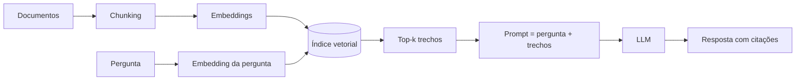

# Miniguia de Estudo: RAG (Retrieval-Augmented Generation)

> Consolidado a partir das 5 fontes em [`sources/fontes.yaml`](../sources/fontes.yaml) (F1 a F5).
> Conferir cada afirmação no NotebookLM (clique nas citações) antes de considerar "aprendido".

## 1. O que é RAG

RAG combina um **modelo de linguagem** (memória paramétrica, guardada nos pesos) com um **mecanismo de busca** sobre uma base externa (memória não paramétrica). Antes de responder, o sistema recupera trechos relevantes e os entrega ao modelo como contexto. Origem: F1.

**Por que existe:** modelos param no tempo, alucinam e não conhecem dados privados. RAG dá acesso a informação atual, permite citar fontes e evita retreinar o modelo a cada mudança.

## 2. Pipeline básico (Naive RAG)

1. **Indexação (offline):** dividir documentos em *chunks*, gerar *embeddings* e armazenar em índice vetorial.
2. **Recuperação (online):** transformar a pergunta em vetor e buscar os *k* trechos mais próximos.
3. **Geração:** montar o prompt com os trechos e pedir uma resposta fundamentada.

## 3. Evolução: Naive, Advanced e Modular RAG (F2)

| Geração | Ideia central | Técnicas típicas |
|---|---|---|
| Naive RAG | Indexar, recuperar, gerar | Chunks fixos, busca vetorial simples |
| Advanced RAG | Melhorar antes e depois da busca | Reescrita de consulta, busca híbrida, reranking, compressão de contexto |
| Modular RAG | Peças combináveis e roteadas | Roteadores, múltiplas fontes, laços de reflexão, ferramentas |

## 4. Técnicas que mais impactam a qualidade

- **Chunking com sobreposição e respeito à estrutura** (títulos, parágrafos) evita cortar ideias ao meio.
- **Busca híbrida** (lexical BM25 + densa) cobre termos exatos e semântica.
- **Reranking** com um modelo mais preciso reordena os candidatos antes de gerar.
- **Reescrita/expansão de consulta** (ex.: gerar uma resposta hipotética e buscar por ela) reduz a distância entre pergunta e documento.
- **Self-RAG (F5):** o modelo decide *quando* recuperar e emite "tokens de reflexão" para criticar relevância e suporte da própria resposta.

## 5. Contexto longo não resolve tudo (F3)

O estudo mostra que o desempenho tende a **cair quando a informação relevante está no meio** de um contexto longo e é melhor no início ou no fim. Consequências práticas: recuperar menos trechos porém melhores, **reordenar** colocando o mais relevante nas pontas e evitar despejar o documento inteiro.

## 6. Como avaliar (F4)

Avalie recuperação e geração separadamente. Métricas do RAGAS:

| Métrica | Pergunta que responde |
|---|---|
| Faithfulness (fidelidade) | A resposta é sustentada pelo contexto recuperado? |
| Answer relevancy | A resposta atende à pergunta? |
| Context precision | Os trechos úteis aparecem nas primeiras posições? |
| Context recall | O contexto recuperado contém o necessário? |

## 7. Erros comuns e mitigação

| Sintoma | Causa provável | Mitigação |
|---|---|---|
| Resposta correta ignorando o documento | Recuperação falhou | Busca híbrida, reranking, reescrita de consulta |
| Resposta inventada com citação plausível | Falta de checagem de suporte | Verificação de fidelidade, resposta "não sei" permitida |
| Trechos irrelevantes | Chunk grande ou pequeno demais | Ajustar tamanho, sobreposição e estrutura |
| Piora com muitos trechos | Efeito "lost in the middle" | Menos trechos, reordenação |

## 8. Checklist de revisão rápida

- [ ] Sei explicar RAG sem consultar as fontes?
- [ ] Sei desenhar o pipeline de memória?
- [ ] Sei citar 3 técnicas de Advanced RAG e quando usar?
- [ ] Sei explicar por que contexto longo não substitui recuperação?
- [ ] Sei escolher métricas para diagnosticar retrieval versus geração?
